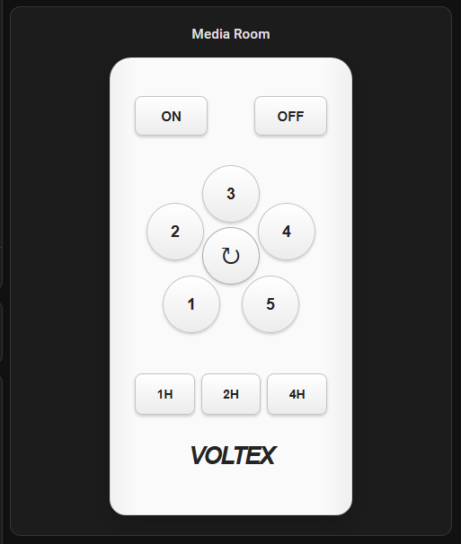

# Voltex Fan Remote Card

An unofficial Home Assistant dashboard card matching the Voltex CFB
five-speed ceiling fan remote without a light.



Each position can be assigned to a stateless MQTT `button` entity discovered
by the ESP32 CC1101 fan controller. The card includes ON, OFF, speeds 1–5,
reverse, and 1/2/4-hour timer controls.

## Install with HACS

Until the card is included in HACS's default repositories:

1. Open **HACS → three-dot menu → Custom repositories**.
2. Enter this repository's GitHub URL.
3. Select **Dashboard** as the category and choose **Add**.
4. Open **Voltex Fan Remote Card** and choose **Download**.
5. Refresh Home Assistant, then add **Voltex Fan Remote** to a dashboard.

HACS normally registers the dashboard resource automatically. If it does not,
add `/hacsfiles/voltex-fan-remote-card/voltex-fan-remote-card.js` as a
JavaScript module under **Settings → Dashboards → Resources**.

## Configure

The visual editor lists Home Assistant `button` entities for every position.
Choose the corresponding MQTT entities published by the fan controller.

```yaml
type: custom:voltex-fan-remote-card
title: Lounge Fan
on_entity: button.fan_controller_on
off_entity: button.fan_controller_off
speed_1_entity: button.fan_controller_speed_1
speed_2_entity: button.fan_controller_speed_2
speed_3_entity: button.fan_controller_speed_3
speed_4_entity: button.fan_controller_speed_4
speed_5_entity: button.fan_controller_speed_5
reverse_entity: button.fan_controller_reverse
timer_1h_entity: button.fan_controller_1_hour_timer
timer_2h_entity: button.fan_controller_2_hour_timer
timer_4h_entity: button.fan_controller_4_hour_timer
```

Entity IDs depend on the command names present when Home Assistant first
discovers them. Renaming or cleaning a controller command preserves its MQTT
unique ID and keeps the card assignment connected.

## Release

The repository name must be `voltex-fan-remote-card`. Before publishing a
release, check that `dist/voltex-fan-remote-card.js` contains the intended
version and that the validation workflow passes. Create a full GitHub release
with a semantic tag such as `v0.1.0`; a tag without a release is not treated as
a HACS release.

Voltex is a trademark of its respective owner. This community project is not
affiliated with or endorsed by Voltex Electrical.

